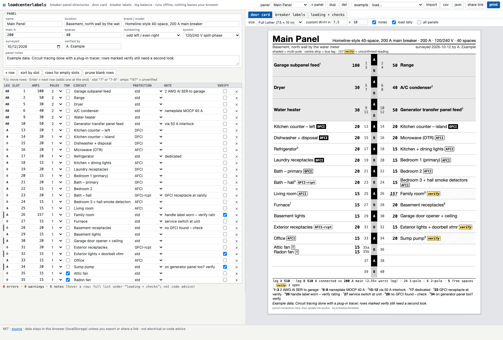
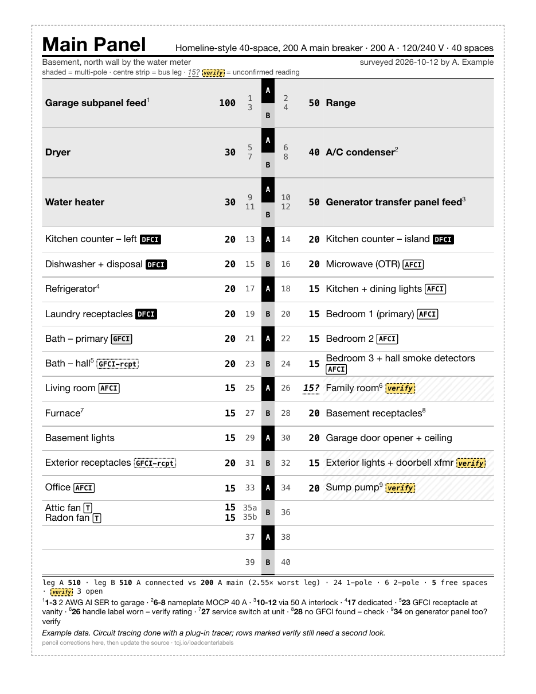
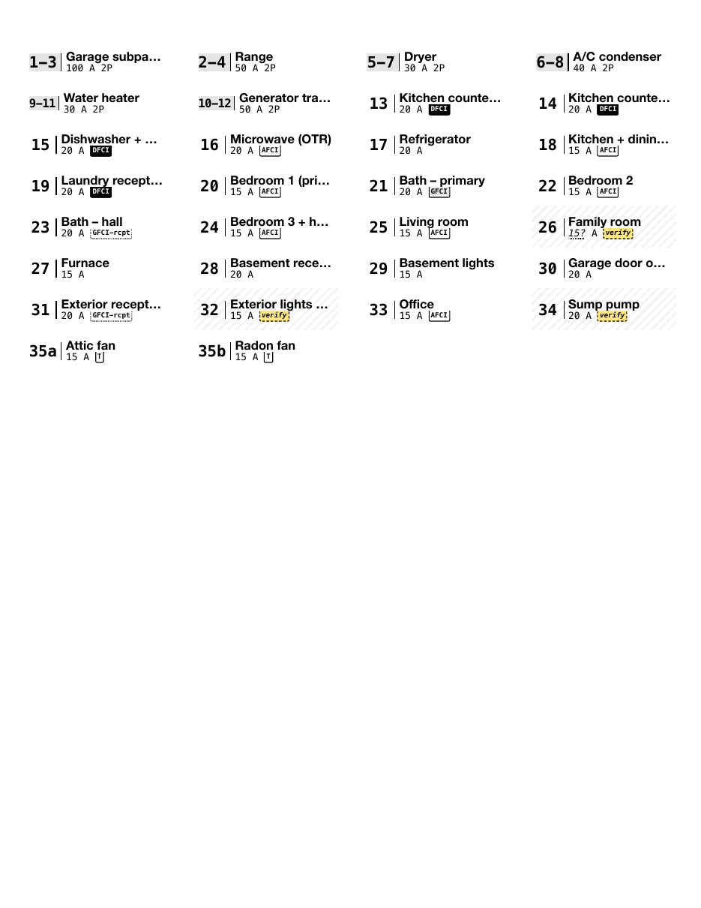

# loadcenterlabels

**→ https://tcj.io/loadcenterlabels/**

A free, offline, single-page tool for breaker-panel (load center) directories:

- a **printable panel-door card** (Letter/A4, half-letter, narrow-door and custom sizes),
- a sheet of **per-breaker labels** (Avery 5167/5160/5195/L7651/L7656 or custom geometry, with "start at label N" for partly used sheets),
- a **leg-balance / connected-load summary** with soft checks.

Its one opinion: **an unverified reading is an output, not a secret.**
Type `15?` for a rating you couldn't read, tick *verify*, or write "verify" in the note, and the printed card shows the number in italics with a yellow dashed `verify` chip and a hatched cell.
The open questions go on the door with the answers, so the next person with a flashlight knows what to check.



| printed door card | printed label sheet |
|---|---|
|  |  |

## What it does

- **Editable grid**: slot, amps, poles (1/2/3), tandem, circuit, protection (std / AFCI / GFCI / DFCI / GFCI-at-receptacle), note, verify. Keyboard-first: ↑/↓ move between rows, Enter goes to the next row (and adds one at the end).
- **Panel meta**: name, location, brand/model, main amps, spaces, numbering (odd-left/even-right, or sequential down the left then the right), 120/240 V split-phase or 3-phase, survey date, verified-by, notes.
- **Multiple panels** per document (main + subpanel + generator panel), with "all panels" printing.
- **Import/export** CSV and JSON. CSV import tolerates home-made headers (`Breaker, Amps, Description, Type` etc.) and infers poles from `1-3`.
- **Share links**: the whole document deflate-compressed into the URL hash (`#d=…`). The fragment never reaches a server. Opening a link appends its panels to whatever is already saved in that browser; it never overwrites.
- **Autosave** to `localStorage` (wrapped so private mode just doesn't save), **offline** after first load (a network-first service worker), no trackers, no fonts or scripts from anywhere else.

## Leg math

North American panels alternate bus stabs down the panel: with odd/even numbering, slots 1 and 2 share row 1 (leg A), 3 and 4 share row 2 (leg B), and so on.
A 2-pole breaker takes two vertically adjacent slots (`n`, `n+2`), so it always lands on both legs, which is how it gets 240 V.
If you type an explicit pole list that puts both poles on one leg (e.g. `1-2`), that's flagged as impossible: your numbering is off somewhere.
3-phase panels cycle A/B/C by row.

The summary adds each breaker's handle rating to every leg it lands on: **connected load**, i.e. what each leg could draw if every circuit ran at its trip rating at once.
It's shown against 1× (tick) and 3× (bar end) the main, with left/right column totals, 1-pole/2-pole counts, 240 V amps and free spaces.
Connected capacity of 2–3× the main is normal; this is **not** an NEC 220.82 demand calculation, which applies diversity and comes out far lower.
It's for balance, headroom in spaces, and deciding where the next 240 V load goes.

Soft checks: overlapping slots (tandem pairs and quads allowed), out-of-range slots, 2-poles across columns or on one leg, 3-poles in split-phase panels, breakers larger than the main, connected load beyond 3× the main, and "AFCI/GFCI is typical for a circuit named like this". They are **not code advice**; local code, the code cycle your house was built under, and an electrician win.

## Develop

```sh
npm install
npm run dev        # vite on :5173
npm test           # vitest: leg assignment, validation, CSV + hash round-trips, renderers
npm run build      # static files in dist/ with relative URLs, servable from any subpath
scripts/deploy.sh [--dry-run]       # test, build, rsync to tcj.io
scripts/screenshots.sh [url] [dir]  # headless-Chrome screenshots + real print output (needs pdftoppm)
```

Plain TypeScript + Vite, no runtime dependencies. `src/model.ts` (geometry, legs, validation, summary) and `src/render.ts` (card/labels/summary HTML) are pure and unit-tested; `src/main.ts` is the DOM glue.

The example panels are fictional.

MIT licensed.
